<a href="https://namuruiwatani.github.io">
  <picture>
    <source media="(prefers-color-scheme: dark)" srcset="https://raw.githubusercontent.com/namuruiwatani/namuruiwatani/main/assets/hero-dark.svg">
    
  </picture>
</a>

[сайт](https://namuruiwatani.github.io) · [заметки](https://namuruiwatani.github.io/rss.xml) · [leetcode](https://leetcode.com/u/namuruiwatani/) · [почта](mailto:dev.namuru@gmail.com)

Бэкенд и интерфейсы: PHP, TypeScript, немного Vue. Сайты — на Astro. Разбираю системы на части, чтобы понять, как они держатся, и записываю то, что понял.

## Стек

<picture>
  <source media="(prefers-color-scheme: dark)" srcset="https://raw.githubusercontent.com/namuruiwatani/namuruiwatani/main/assets/stack-dark.svg">
  
</picture>

## Языки

<picture>
  <source media="(prefers-color-scheme: dark)" srcset="https://raw.githubusercontent.com/namuruiwatani/namuruiwatani/main/assets/langs-dark.svg">
  
</picture>

## Заметки

<!-- BLOG-POSTS:START -->- [После возвращения](https://namuruiwatani.github.io/blog/posle-vozvrashcheniya/) · 09.11.2026- [Те же улицы](https://namuruiwatani.github.io/blog/te-zhe-ulitsy/) · 09.11.2026- [HackerTube: другой способ искать видео](https://namuruiwatani.github.io/blog/hackertube/) · 08.11.2026- [arXiv — открытая мастерская науки](https://namuruiwatani.github.io/blog/arxiv-otkrytaya-masterskaya/) · 07.11.2026- [Почему пару дней не было новых заметок](https://namuruiwatani.github.io/blog/pochemu-ne-publikoval-v-poezdke/) · 07.11.2026<!-- BLOG-POSTS:END -->
